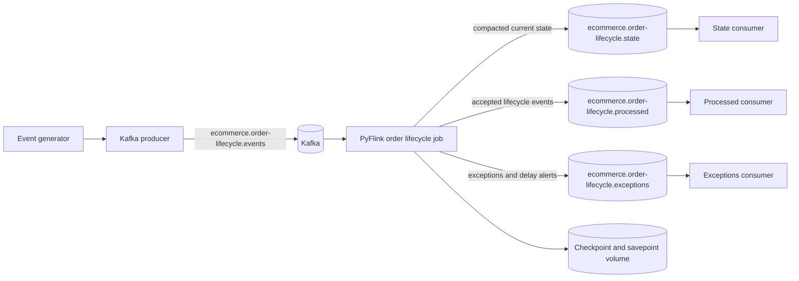
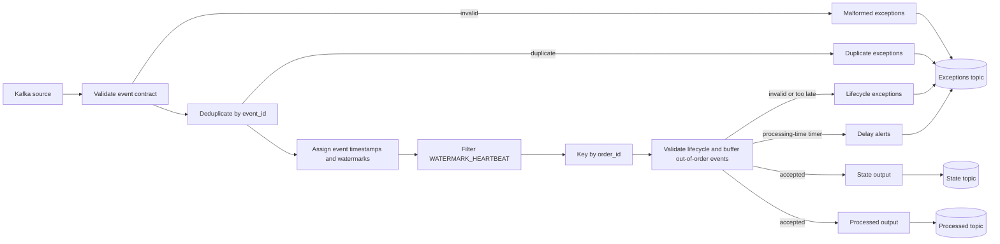
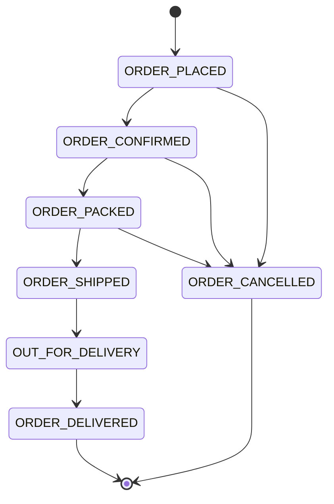

# E-commerce Order Lifecycle and Event Processing

A real-time order lifecycle pipeline built with **Kafka**, **PyFlink**, and
**Python 3.11**. The project validates, deduplicates, orders, and analyzes
e-commerce order events, then publishes current order state, accepted events,
and operational exceptions back to Kafka.

The implementation is complete for the local portfolio scope:

- event generation and Kafka ingestion
- event-time lifecycle processing with watermarks
- duplicate, late, out-of-order, malformed, and invalid-transition handling
- event-time stage and total delivery durations
- processing-time delay and stuck-order alerts
- compacted order-state output and independent Kafka consumers
- checkpoint, savepoint, and TaskManager-failure recovery
- unit tests and a repeatable local demonstration

## Architecture



Detailed diagrams and component responsibilities are in
[`docs/architecture/architecture.md`](docs/architecture/architecture.md).

## Flink pipeline



## Lifecycle



The first accepted lifecycle event for an order must be `ORDER_PLACED`.
`ORDER_DELIVERED` and `ORDER_CANCELLED` are terminal. All other non-matching
transitions are published to the exceptions topic.

## Kafka topics

| Topic | Purpose | Retention | Key |
|---|---|---|---|
| `ecommerce.order-lifecycle.events` | Raw input events | Configured by Kafka | `order_id` |
| `ecommerce.order-lifecycle.state` | Latest accepted state per order | Compacted | `order_id` |
| `ecommerce.order-lifecycle.processed` | Accepted lifecycle events with durations | Configured by Kafka | `order_id` |
| `ecommerce.order-lifecycle.exceptions` | Malformed, duplicate, late, invalid, and delay alerts | Configured by Kafka | `order_id`, `event_id`, or `unknown` |

Topic settings are documented in
[`config/kafka_topics.yaml`](config/kafka_topics.yaml). Existing shared Kafka
topics must not be altered. Project topics are created independently only when
they do not already exist.

## Event contract

Input events are JSON objects with exactly these fields:

```json
{
  "schema_version": "1.0",
  "event_id": "4f437c2d-1b1a-4a9a-9a3d-8d6f2f1f5c11",
  "order_id": "ORD-ABC12345",
  "event_type": "ORDER_PLACED",
  "event_timestamp": "2026-01-01T10:00:00Z",
  "source": "order_service"
}
```

`event_id` must be a UUID. `event_timestamp` must include a timezone.
`WATERMARK_HEARTBEAT` events use `source=system` and are removed before
lifecycle processing; they exist only to advance event time when business
traffic is idle. See
[`schemas/order_event.schema.json`](schemas/order_event.schema.json) and
[`docs/data_contracts/event_contracts.md`](docs/data_contracts/event_contracts.md).

## Processing behavior

### Validation and deduplication

- Events must match the required contract and accepted enum values.
- Malformed events are written to the exceptions topic with
  `exception_type=MALFORMED_EVENT`.
- Each stream is keyed by `event_id`; a previously seen ID is written as
  `DUPLICATE_EVENT` and does not advance lifecycle state.

### Event time and ordering

- The job uses `event_timestamp`, not processing time, for lifecycle order.
- A 5-minute bounded out-of-orderness watermark is used.
- Events are buffered by `order_id` until their event-time timer fires.
- Events at or before the current watermark are written as `EVENT_TOO_LATE`.
- Heartbeats may be used by the generator to advance the watermark when no
  business event arrives.

### Durations and delay alerts

- Stage durations are calculated from the previous accepted event timestamp.
- Total delivery duration is calculated from `ORDER_PLACED` to
  `ORDER_DELIVERED`.
- Delay alerts use processing-time timers so they can fire without new input.
- Thresholds are configurable in
  [`config/processing_rules.json`](config/processing_rules.json).
- Alerts are published to the exceptions topic with
  `exception_category=DELAY_ALERTS`.
- A false alert is suppressed when a pending valid transition or cancellation
  would complete the stage within the configured event-time threshold.

See
[`docs/design_decisions/duration_and_delay_detection.md`](docs/design_decisions/duration_and_delay_detection.md)
for clock semantics and timer behavior.

## Recovery and delivery semantics

Flink state is checkpointed every 60 seconds to the shared volume mounted at
`/opt/flink/usrlib/flink-state`. The job uses the HashMap state backend, a
bounded fixed-delay restart strategy, and stable managed-state names.

- Flink-managed state and source offsets recover from checkpoints.
- Savepoints can be created and used to restore a new job.
- Kafka sinks are **at-least-once**, not transactional.
- Output records written after the last successful checkpoint may be written
  again after recovery. Consumers must tolerate or deduplicate duplicates.

See
[`docs/design_decisions/checkpointing_and_recovery.md`](docs/design_decisions/checkpointing_and_recovery.md)
for the configuration and recovery procedure.

## Repository layout

```text
config/                         Project topics and delay thresholds
data/                           Generated and scenario-data directories
docs/                           Architecture, contracts, decisions, demo, testing
schemas/                        JSON schemas
scripts/                        Local convenience scripts
src/order_lifecycle/consumers/  Independent output consumers
src/order_lifecycle/flink/      PyFlink job, Java serializer, job resources
src/order_lifecycle/generator/  Scenario and continuous event generator
src/order_lifecycle/kafka/      Kafka producer
tests/unit/                     Unit tests
tests/integration/              Integration test location
tests/e2e/                      End-to-end test location
```

## Prerequisites

- Python 3.11
- Docker Desktop with the shared lab running
- The existing `flink-jobmanager`, `flink-taskmanager`, and
  `kafka_kraft_docker` containers
- Network access from Flink containers to Kafka on `kafka_kraft_docker:29092`

The shared Docker lab is reused without modification. No Compose changes,
additional services, infrastructure reinstalls, or changes to existing Kafka
topics are required.

## Setup

From the repository root:

```powershell
python -m venv .venv
.\.venv\Scripts\Activate.ps1
python -m pip install --upgrade pip
python -m pip install -e .
```

Verify the containers:

```powershell
docker ps --format "table {{.Names}}\t{{.Status}}"
```

## One-click demo dashboard (recommended)

Primary launcher: `START_DEMO.bat` (project root).

1. Double-click `START_DEMO.bat` (or run it from the repo root). It uses `.venv`, starts the FastAPI dashboard backend, waits for `/api/health`, and opens `http://127.0.0.1:8090` automatically. If the dashboard is already healthy, it opens the browser without starting a duplicate backend. The console stays open for logs; startup errors are shown clearly. **It does not start/stop Docker containers or delete persistent data.**
2. In the browser, use **START DEMO ENVIRONMENT** on the startup screen. The backend orchestrates sequentially (idempotent, reuses running services/jobs): check Docker → start/ensure Kafka (existing DockerLab compose) → wait for Kafka → verify input/output topics → start/ensure Flink → wait for JobManager/TaskManager → reuse or submit existing Flink job → wait for `RUNNING` → connect dashboard Kafka monitors → verify live monitoring. Progress/checks update in real time; on failure the exact step and reason are shown and pressing **START DEMO ENVIRONMENT** again retries safely. **Refresh Status** is non-destructive.
3. When **DEMO ENVIRONMENT READY** is shown, use the sidebar to access **Demo Setup, Overview, Live Events, Order States, Exceptions & Alerts, Flink & Checkpoints, Infrastructure, Architecture, Demo Guide**. Toggle **Demo/Technical** mode. Use **Event Generator** controls to run existing scenarios. **Demo Setup** always returns to the startup/status screen.
4. **Stop Demo Environment** (safe, confirmed): stops the project Flink job and only project containers `kafka_kraft_docker`, `flink-taskmanager`, `flink-jobmanager`. No `docker compose down`, no volume/checkpoint/savepoint deletion, no unrelated containers. Closing the browser does not stop infrastructure. Stop the dashboard backend with `Ctrl+C` in the launcher console.

Details: [`dashboard/README.md`](dashboard/README.md). Manual backend-only start remains available via `run_dashboard.bat`.

## Run the demonstration

The full step-by-step demo is in
[`docs/demo/demo_guide.md`](docs/demo/demo_guide.md). A minimal run is:

### 1. Create project topics if they do not exist

```powershell
docker exec kafka_kraft_docker /opt/kafka/bin/kafka-topics.sh --bootstrap-server localhost:29092 --create --if-not-exists --topic ecommerce.order-lifecycle.events --partitions 2 --replication-factor 1
docker exec kafka_kraft_docker /opt/kafka/bin/kafka-topics.sh --bootstrap-server localhost:29092 --create --if-not-exists --topic ecommerce.order-lifecycle.state --partitions 2 --replication-factor 1 --config cleanup.policy=compact
docker exec kafka_kraft_docker /opt/kafka/bin/kafka-topics.sh --bootstrap-server localhost:29092 --create --if-not-exists --topic ecommerce.order-lifecycle.processed --partitions 2 --replication-factor 1
docker exec kafka_kraft_docker /opt/kafka/bin/kafka-topics.sh --bootstrap-server localhost:29092 --create --if-not-exists --topic ecommerce.order-lifecycle.exceptions --partitions 2 --replication-factor 1
```

### 2. Submit the Flink job

Copy the job directory, serializer JAR, and processing rules into the
JobManager container, then submit:

```powershell
docker exec flink-jobmanager mkdir -p /tmp/order-lifecycle/config
docker cp src/order_lifecycle/flink/. flink-jobmanager:/tmp/order-lifecycle/
docker cp config/processing_rules.json flink-jobmanager:/tmp/order-lifecycle/config/processing_rules.json
docker exec flink-jobmanager flink run -d -py /tmp/order-lifecycle/order_lifecycle_job.py
docker exec flink-jobmanager flink list
```

The job must be `RUNNING` before publishing events because the Flink Kafka
source starts at the latest offsets.

Check the REST API at
`http://localhost:18081/jobs/<job-id>/checkpoints`.

### 3. Publish demo scenarios

Finite scenarios use event timestamps relative to the current run. A
heartbeat from one scenario advances the event-time watermark, so a later
finite scenario can be classified as too late if it is run against the same
long-lived job. For a clean scenario-by-scenario demonstration, submit a fresh
job before each finite scenario. Continuous mode does not have this limitation.

```powershell
python -m order_lifecycle.kafka.producer --scenario normal_flow
python -m order_lifecycle.kafka.producer --scenario duplicate_events
python -m order_lifecycle.kafka.producer --scenario late_events
python -m order_lifecycle.kafka.producer --scenario out_of_order_events
python -m order_lifecycle.kafka.producer --scenario invalid_events
```

### 4. Read the outputs

Each consumer is independent and can run in its own terminal:

```powershell
python -m order_lifecycle.consumers.state_consumer --from-beginning --max-messages 3 --idle-timeout 10
python -m order_lifecycle.consumers.processed_consumer --from-beginning --max-messages 3 --idle-timeout 10
python -m order_lifecycle.consumers.exceptions_consumer --from-beginning --max-messages 3 --idle-timeout 10
```

Consumer settings can be overridden with environment variables:

| Variable | Default |
|---|---|
| `KAFKA_BOOTSTRAP_SERVERS` | `localhost:9092` |
| `KAFKA_STATE_TOPIC` | `ecommerce.order-lifecycle.state` |
| `KAFKA_PROCESSED_TOPIC` | `ecommerce.order-lifecycle.processed` |
| `KAFKA_EXCEPTIONS_TOPIC` | `ecommerce.order-lifecycle.exceptions` |
| `KAFKA_STATE_CONSUMER_GROUP` | `order-lifecycle-state-consumer` |
| `KAFKA_PROCESSED_CONSUMER_GROUP` | `order-lifecycle-processed-consumer` |
| `KAFKA_EXCEPTIONS_CONSUMER_GROUP` | `order-lifecycle-exceptions-consumer` |

For continuous demo traffic:

```powershell
python -m order_lifecycle.kafka.producer --scenario continuous --interval 2
```

Then run any consumer without `--max-messages` or `--from-beginning`.

## Tests

Run the unit suite from the repository root:

```powershell
.\.venv\Scripts\python.exe -m unittest discover -s tests\unit -v
```

Expected: **85 tests, OK**.

The suite covers event validation, lifecycle rules, deduplication, event-time
ordering, watermark heartbeats, durations, delay alerts, Kafka output records,
checkpoint configuration, consumer parsing/formatting, consumer configuration,
and manual-assignment fallback.

## Validation performed

- 85 unit tests pass.
- All five event scenarios were validated end to end in isolated job runs.
- State, processed, and exceptions topics produced records.
- All three independent consumers were run against Kafka and displayed
  records.
- Checkpoints completed and were written to the shared Flink volume.
- A TaskManager restart restored the latest checkpoint and continued
  processing.
- A restored buffered event advanced lifecycle state after recovery.
- A restored processing-time timer emitted a delay alert.
- A republished event ID was routed as a duplicate after recovery.
- Stop-with-savepoint and restore-from-savepoint both completed.

## Known limitations

- The shared Kafka broker is configured with
  `offsets.topic.replication.factor=3` while only one broker is available, so
  Kafka cannot create the internal consumer-offset topic. Consumers therefore
  fall back from consumer-group assignment to manual partition assignment.
  They still use separate configured group IDs in code, but offsets are not
  committed in this environment. A correctly configured broker uses normal
  consumer groups.
- Kafka sinks are at-least-once; duplicate output is possible after recovery.
- The Flink source starts at latest offsets; publish demo events after the job
  is running.
- The local deployment uses one JobManager, no HA metadata store, HashMap
  state, and local filesystem checkpoints.
- Checkpoint and savepoint cleanup is not automated.
- Integration and end-to-end test directories are present, but the validated
  coverage in this repository is unit tests plus documented manual runs.

## Documentation

- [Architecture](docs/architecture/architecture.md)
- [Business requirements](docs/business_requirements/requirements.md)
- [Event contracts](docs/data_contracts/event_contracts.md)
- [Event flow](docs/data_flow/event_flow.md)
- [Execution guide](docs/execution/execution_guide.md)
- [Demo guide](docs/demo/demo_guide.md)
- [Testing strategy](docs/testing/testing_strategy.md)
- [Design decisions](docs/design_decisions/decisions.md)
- [Duration and delay detection](docs/design_decisions/duration_and_delay_detection.md)
- [Checkpointing and recovery](docs/design_decisions/checkpointing_and_recovery.md)
