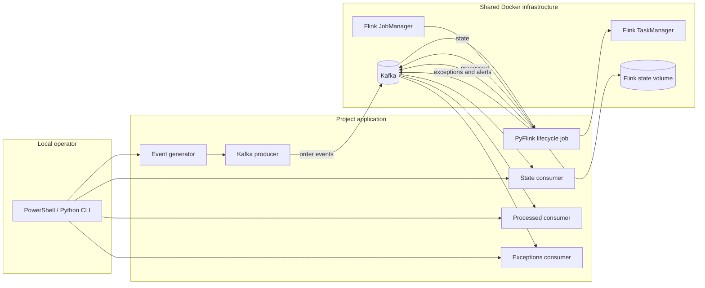
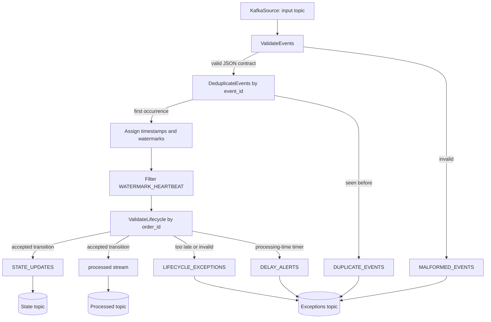
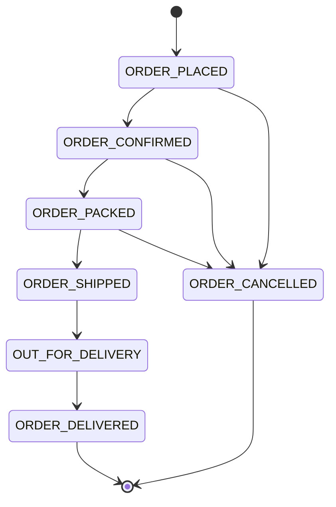
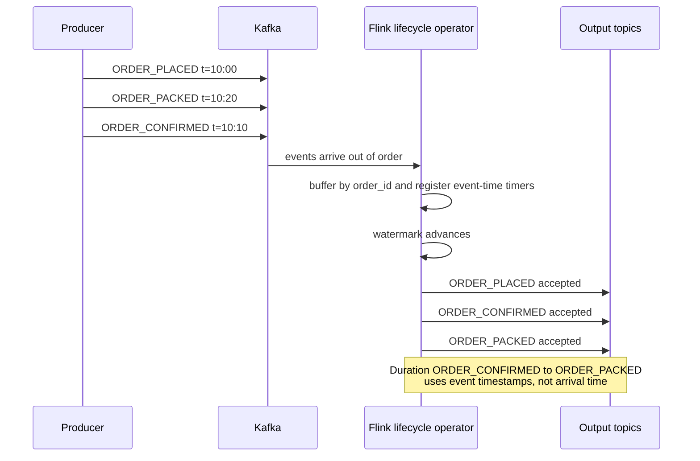
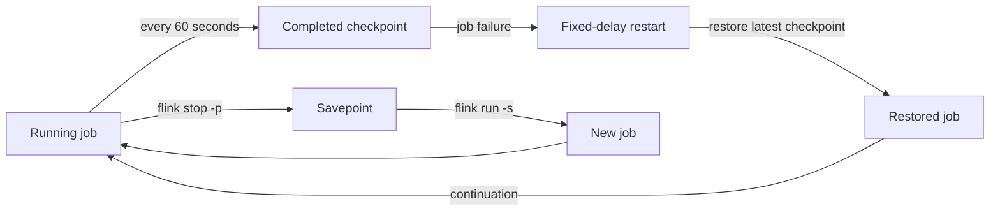

# Architecture

## Overview

The system is a streaming order-lifecycle processor. A Python producer
publishes synthetic order events to Kafka. A PyFlink job consumes the raw
events, validates and deduplicates them, applies event-time ordering and
lifecycle rules, and publishes three output streams back to Kafka. Independent
Python consumers display current state, accepted events, and exceptions.

The project reuses the existing shared Docker lab. It adds only project-specific
Kafka topics and Flink job resources.

## System context

## Components

| Component | Responsibility |
|---|---|
| `src/order_lifecycle/generator/event_generator.py` | Generates normal, duplicate, late, out-of-order, invalid, and continuous scenarios. Adds watermark heartbeats to finite scenarios. |
| `src/order_lifecycle/kafka/producer.py` | Publishes generated events to the input topic with `order_id` as key. |
| `src/order_lifecycle/flink/order_lifecycle_job.py` | Defines the complete PyFlink topology, state, timers, recovery configuration, and Kafka sinks. |
| `src/order_lifecycle/flink/java/RowFieldExtractorSchema.java` | Extracts the Kafka key or payload field from a Flink row for the sink serializer. |
| `src/order_lifecycle/flink/lib/order-lifecycle-serializers.jar` | Compiled Java serializer used by the Kafka sinks. |
| `src/order_lifecycle/consumers/state_consumer.py` | Displays retained compacted state records. |
| `src/order_lifecycle/consumers/processed_consumer.py` | Displays accepted lifecycle records. |
| `src/order_lifecycle/consumers/exceptions_consumer.py` | Displays malformed, duplicate, late, invalid-transition, and delay-alert records. |
| Shared Docker Kafka | Durable event transport. Existing infrastructure is reused without modification. |
| Shared Docker Flink | Job execution and checkpoint/savepoint storage. |

## Flink topology

## Lifecycle state

`ALLOWED_TRANSITIONS` in the job is the executable source of truth. Any event
that does not match the current status is emitted as
`INVALID_LIFECYCLE_TRANSITION`.

## Event-time ordering

## Recovery

Checkpoint and savepoint data is stored under
`/opt/flink/usrlib/flink-state` in the shared Flink volume. The job uses
stable managed-state names so state can be restored without
`--allowNonRestoredState`.

## Topic and output design

| Topic | Record type | Key | Delivery |
|---|---|---|---|
| Input | Raw JSON event | `order_id` | Producer `acks=all`, retries |
| State | Current order state with durations | `order_id` | At-least-once |
| Processed | Accepted event plus lifecycle metadata | `order_id` | At-least-once |
| Exceptions | Error, duplicate, lateness, invalid transition, delay alert | `order_id` or `event_id` fallback | At-least-once |

The state topic is compacted so consumers can display the latest retained
value per order. The exceptions topic combines multiple exception categories;
`exception_type` and `exception_category` distinguish them.

## Consumer design

Each consumer has its own module, default topic, default group ID, and output
formatter. They all share connection, argument, JSON parsing, reconnect, and
record formatting helpers in `consumers/common.py`.

Consumers support:

- `--from-beginning` for retained history
- `--max-messages` for scripted checks
- `--idle-timeout` for bounded runs
- `--group-id`, `--bootstrap-servers`, and topic/group environment variables
- malformed-record skipping without stopping the consumer

If Kafka consumer-group coordination is unavailable, consumers fall back to
manual partition assignment so records can still be read. See the limitation in
the README.

## Infrastructure boundaries

- The shared Docker Compose stack, Kafka broker, Flink containers, and existing
  topics are not modified.
- Project topics are created independently and must not replace or reconfigure
  existing shared topics.
- Checkpoints and savepoints are project data under the shared Flink volume.
- No additional services are required for the demonstration.
- Infrastructure installation and Compose changes are out of scope.

## Open questions

- Production-scale state backend and remote durable checkpoint storage.
- Retention and automated cleanup for checkpoints and savepoints.
- Transactional or idempotent Kafka sinks if end-to-end exactly-once delivery
  becomes a requirement.
- Production Kafka consumer-group quota and internal-topic configuration.
- Automated integration and end-to-end suites in a disposable environment.
