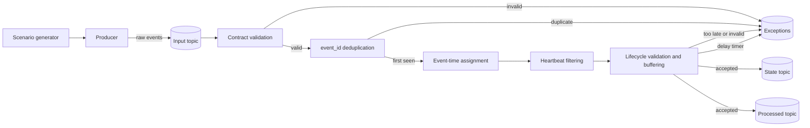

# Event Flow

## Overview

## Stages

### 1. Generation and publication

`event_generator.py` creates a consistent order event sequence with a unique
`order_id` and a UUID per event. Finite scenarios append a
`WATERMARK_HEARTBEAT` ahead of the largest event timestamp so buffered events
can be released without waiting for new business traffic.

`producer.py` serializes each event as JSON and publishes it with the order ID
as key.

### 2. Contract validation

`ValidateEvents` checks JSON shape, field set, schema version, UUID, order ID,
event type, source, and timestamp. Invalid records are routed to the exceptions
topic.

### 3. Deduplication

The stream is keyed by `event_id`. `DeduplicateEvents` keeps a boolean state per
event ID. A repeated ID is routed to exceptions as `DUPLICATE_EVENT`; a first
occurrence continues.

### 4. Event-time assignment

The job extracts `event_timestamp` and applies a 5-minute bounded
out-of-orderness watermark. Heartbeats help advance watermarks during idle
periods, then are filtered out.

### 5. Lifecycle processing

The stream is keyed by `order_id`. `ValidateLifecycle` buffers events and
registers event-time timers. When the timer fires:

- events at or before the watermark become `EVENT_TOO_LATE`
- events are sorted by event timestamp and lifecycle precedence
- each event is checked against `ALLOWED_TRANSITIONS`
- accepted events emit state and processed records
- invalid transitions emit `INVALID_LIFECYCLE_TRANSITION`

### 6. Delay alerts

Each accepted non-terminal stage schedules a processing-time timer. When it
fires, the job checks whether the stage is still current and whether a pending
valid transition would complete the stage within the event-time threshold. If
not, it emits a `STAGE_DELAYED` or `ORDER_DELIVERY_DELAYED` alert.

## Scenario flows

| Scenario | Input behavior | Expected output |
|---|---|---|
| `normal_flow` | Six lifecycle events in order, plus heartbeat | Six processed records, final delivered state, no exception |
| `duplicate_events` | One lifecycle event ID appears twice | One `DUPLICATE_EVENT`, state advances once |
| `late_events` | A stage event arrives after later stages and watermark | `EVENT_TOO_LATE` for the isolated event; valid events continue |
| `out_of_order_events` | Packed event has an earlier event timestamp than expected order | Job buffers and sorts by event time before accepting |
| `invalid_events` | Invalid transition and malformed event | `INVALID_LIFECYCLE_TRANSITION` and `MALFORMED_EVENT` |
| `continuous` | Repeating normal flows with new order IDs | Continuous processed, state, and exception streams |

## Delivery and recovery

- The Kafka source starts at latest offsets.
- Flink state and source offsets are checkpointed.
- Kafka sinks are at-least-once, so recovered jobs can emit duplicate output.
- The state topic is compacted; the processed and exception topics retain the
  configured Kafka history.
